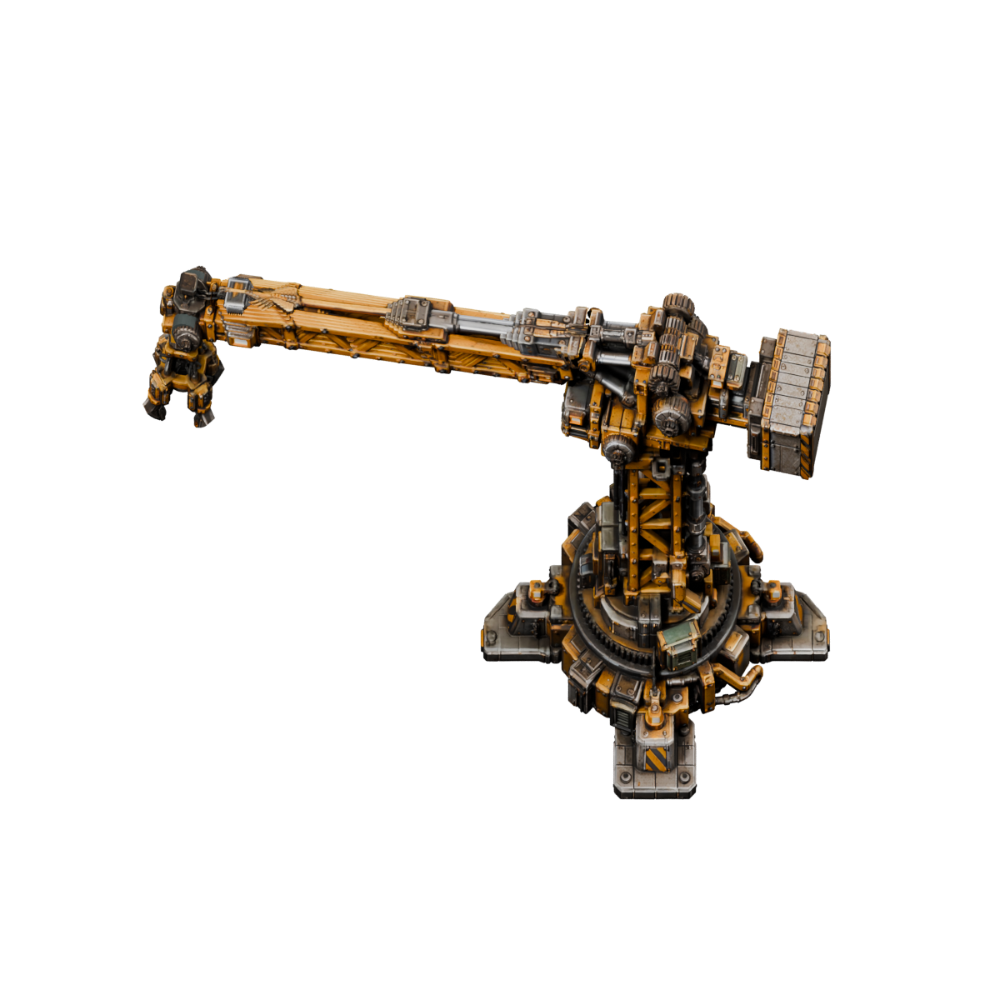
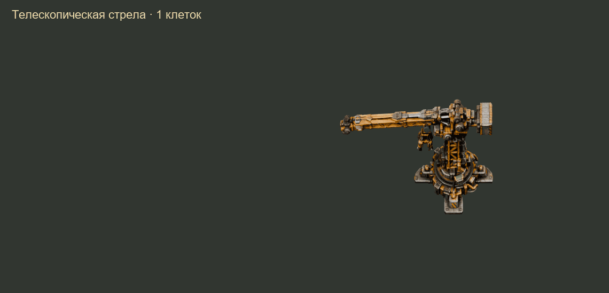

# Telescopic Construction Crane

A stationary electric crane for early construction automation in Factorio. It turns toward a friendly building ghost, extends its boom, places the building using inventory items, and retracts.

**100% vibe-coded with Codex (OpenAI): all mod code was created with AI under the author's direction. The 3D models were generated with Tripo AI.**

[Подробный README на русском](README.md) · [Credits and graphics provenance](CREDITS.md)

[Download the game ZIP — v0.3.0 release](https://github.com/TeamHeightline/heavy-construction-crane/releases/tag/v0.3.0)

Version **0.3.0** (`heavy-construction-crane`), **Factorio 2.0**. Standalone; Space Age is not required. The crane has **10 slots**, a circular **16-tile radius**, a **4×4 footprint**, and **1.8 MW working power** with no steady idle drain.

**Static source and API checks only. No in-game tests were run for this release at the author's request; the author will perform gameplay testing.**

## Unlock and recipe

Research **Construction cranes** after **Automation**: **100 automation science packs**, 30 seconds each. No green science or steel is required.

| Ingredient | Amount |
|---|---:|
| Iron plate | 80 |
| Iron gear wheel | 40 |
| Electronic circuit | 20 |
| Copper plate | 40 |
| Stone brick | 30 |

Craft time: **20 seconds**, producing one crane. **Assembling machines only**, including assembling machine 1; no hand crafting. Chemical plants and oil refineries do not receive the recipe. Compatible modded assemblers are supported through their `crafting`/`advanced-crafting` categories. The initial balance makes both materials and power a substantial early investment.

## Operation

1. Research and assemble the crane, place it, and supply electricity to its base.
2. Open its inventory and load building items. Inserters can supply the inventory.
3. Hover over the crane to see its range, then place friendly building ghosts within the circle.
4. The crane selects a nearby eligible ghost and performs its construction cycle automatically.

A full turn takes 3 seconds, full extension 2 seconds, installation 1 second, and full retraction 2 seconds. Turning follows the shortest path; nearby targets take less time.

Placement requires the **exact item quality and full placement count**. Crane quality never increases the inventory beyond 10 slots. Failed placement restores the original stacks, preserving their metadata or spilling overflow beside the crane. The new entity uses ghost settings; arbitrary metadata from its placement item is not separately applied to the built entity. Compatibility with unusual modded items remains untested.

Only same-force entity ghosts on the same surface are supported. Tiles, terrain work and obstacle removal are excluded. Blocked ghosts are skipped temporarily and retried. Modules, fuel and other additional ghost requests remain normal game requests.

Neighboring cranes reserve different targets. A crane without usable power does not reserve new targets; after one second without power it releases its current target. Motion and installation require electricity. Brief interruptions pause movement; after a longer outage retraction resumes when power returns. Its buffer is only 360 kJ and cannot drive a disconnected crane.

## Graphics

**32 directions × 17 extension poses = 544 sprites**, packed into five atlases. Rendered in Blender from textured parts of the supplied short-boom model. Four nested truss sections provide up to 16 tiles of reach. The supplied extended-boom model was a separate reference; the animation does not morph between the two original meshes. The foundation/mast stays fixed while the upper mechanism turns. Placement previews show the foundation and mast. **Separate ground shadows are not included yet.**

These are animation renders, not gameplay recordings:

Large Blender/USDZ source files are excluded. All required game sprites are included.

## Installation and saves

Download `heavy-construction-crane_0.3.0.zip` from the [release page](https://github.com/TeamHeightline/heavy-construction-crane/releases/tag/v0.3.0). Close Factorio and put the ZIP into your user-profile `mods` directory. Remove old copies of the same mod and enable the new version. Manual packaging requires a `heavy-construction-crane_0.3.0` top-level directory containing this repository's mod files.

Back up saves before upgrading from 0.2.0. Migration is intended to preserve old 80-slot crane contents in the new 10-slot crane, spilling overflow at its base with stack metadata and quality intact. **This migration has not been verified in-game.** Old crane ghosts may disappear, and crane entries in existing blueprints may need replacing. Updates reset incomplete movement; normal saving/loading is designed to retain it. Recipe unlocks are synchronized to the new research without removing existing cranes.

Please include Factorio/mod versions, other enabled mods, reproduction steps, expected/actual results and a relevant log excerpt when reporting a bug. Real electrical behavior and interactions with other mods still need gameplay review.

Concept, direction, model selection and balance: **artel**. All mod code: **100% vibe coding with Codex (OpenAI)**. 3D generation: **Tripo AI**. Scene preparation and rendering: **Blender**. Unofficial Factorio mod; not a Wube Software product.
