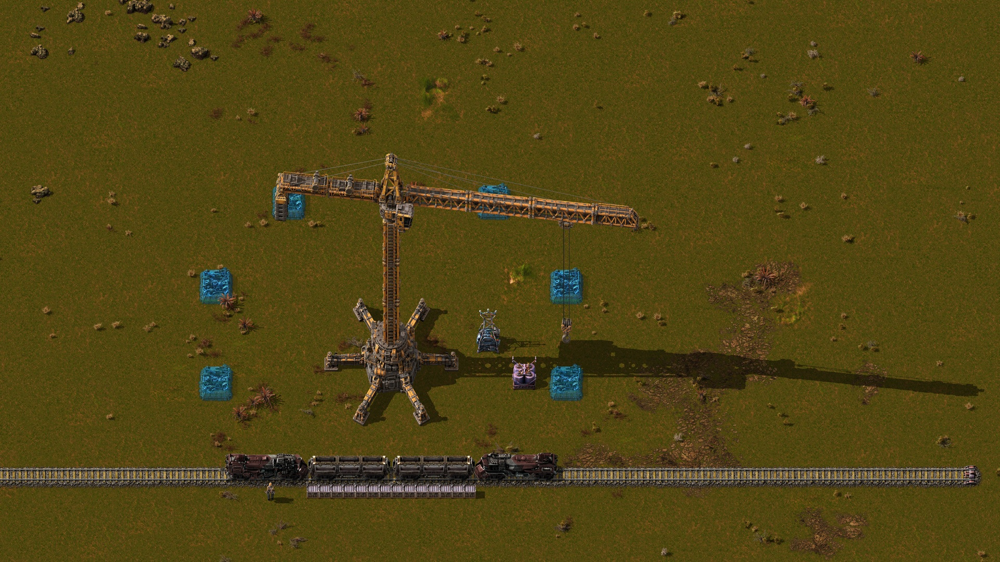
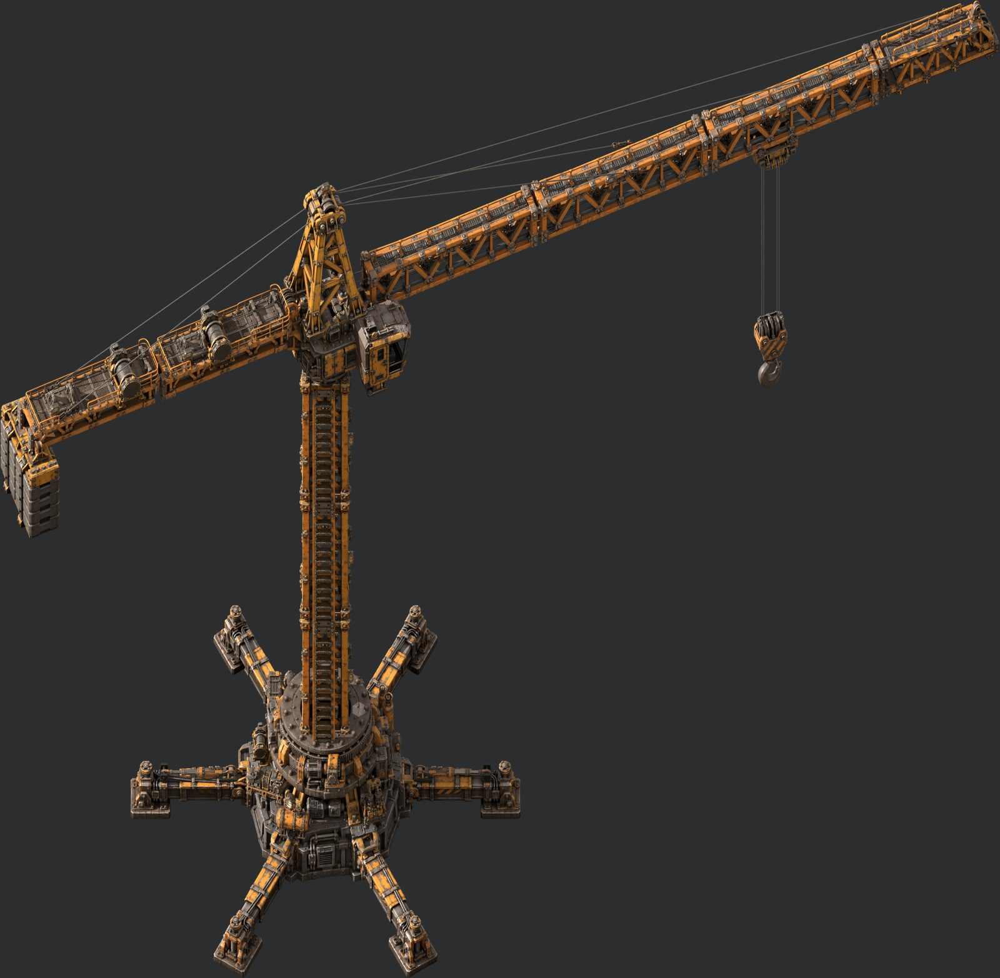

# V2 — Heavy Tower Construction Crane

The second generation of **Heavy Construction Crane** is a tower crane with a rotating jib, travelling trolley and animated hoist. **V2** identifies the crane generation; the current Factorio mod version is **0.1.3**.

[Download the installable ZIP](https://github.com/TeamHeightline/heavy-construction-crane/releases/tag/v2-0.1.3) · [Russian documentation](README.md) · [V1 telescopic source](https://github.com/TeamHeightline/heavy-construction-crane/tree/v1-telescopic) · [V1 release](https://github.com/TeamHeightline/heavy-construction-crane/releases/tag/v0.3.0)

## Requirements and installation

Requires **Factorio 2.1** (`base >= 2.1.0`); tested on **2.1.24**, both base game and Space Age. Space Age is optional.

Copy `heavy-tower-crane_0.1.3.zip` from the release into your Factorio `mods` directory without extracting it, enable **Heavy Tower Construction Crane** and restart the game.

V2 is a standalone mod named `heavy-tower-crane`. It can coexist with V1 (`heavy-construction-crane`). V1 entities are not automatically converted. Existing tower-crane entities from versions 0.1.1/0.1.2 retain their names when upgrading.

## Early railway progression

Research **Tower construction cranes** after **Railway** and basic **Automation**: 150 red and 150 green science packs, 30 seconds per unit.

| Ingredient | Amount |
|---|---:|
| Steel plates | 300 |
| Iron gear wheels | 200 |
| Electronic circuits | 100 |
| Engine units | 40 |
| Stone bricks | 400 |

Assemble in an assembling machine, including assembler 1. Base recipe time: 120 seconds, or 240 seconds in an unmodified assembler 1. The raw-material equivalent without productivity or fuel is 2360 iron ore, 150 copper ore and 800 stone.

## Operation

The crane has a **19.5-tile reach**, **12×12 foundation**, **80 inventory slots** at every quality, a **24 MW peak working load** and a **4.8 MJ buffer**. There is no constant idle drain after the buffer is charged. Lower power slows the crane into intermittent movements; construction was verified with a 3.6 MW supply and a small electric pole.

Supply electricity at the foundation edge, load finished buildings into the crane inventory, and place friendly entity ghosts in range. Item quality must match the ghost exactly. The crane rotates, moves its trolley, lowers the hook and builds the entity. Multiple cranes reserve separate targets. Failed placements refund the original items with their stack data. The crane does not place tiles, clear obstacles or demolish entities.

Open the crane for inventory, status, construction count, energy use and a pause checkbox. The included **Tower crane — test site** scenario provides a powered crane, building items and a train for scale.

## Graphics and verification

The approved crane-v2 model is rendered into 128 directions using native **4096×4096 RGBA** source frames. The mod packs lossless crops of independent foundation, upper assembly, trolley, hook and shadow layers. Hoist lines and night lights are drawn in game. The game sprite density is 90.5 source pixels per tile; displayed size depends on zoom.

Tests in Factorio 2.1.24 cover construction, range limits, power loss, pause/resume, multiple cranes, exact item and quality costs, tagged-item refunds, cleanup, controls and save/load. The current recipe was actually crafted in assembler 1 with only red/green-stage technologies, both with base game and Space Age. All game-layer pixels were checked against the 4K renders, and the graphics files in 0.1.3 match the approved 0.1.2 assets.

Project owner: **artel**. Implementation and render preparation: **artel & Codex (OpenAI)**. Part models: **Tripo AI**. Assembly and rendering: **Blender**. See [CREDITS.md](CREDITS.md) for provenance. Factorio belongs to Wube Software; this is an unofficial mod.
