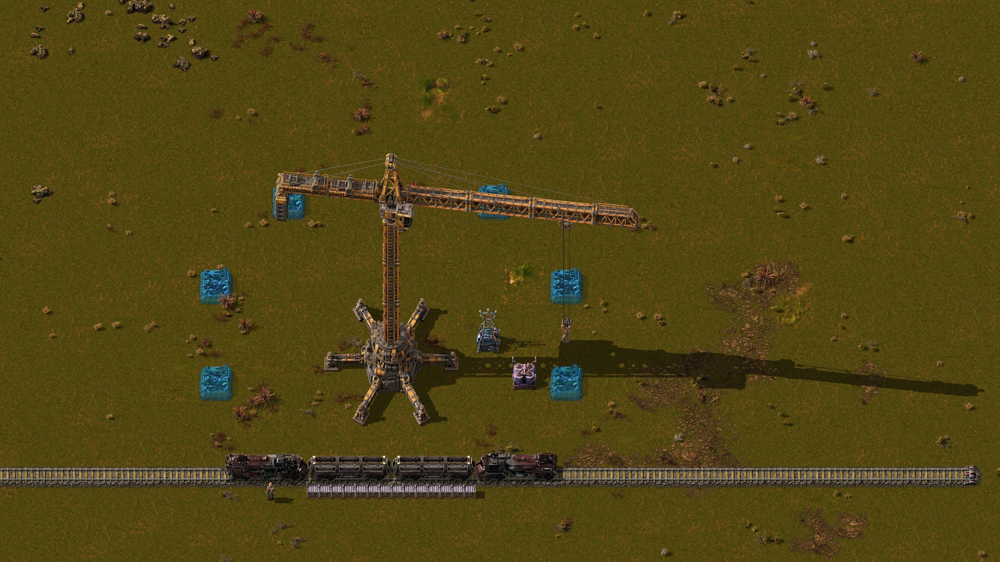

# V2 — Башенный строительный кран

Вторая версия проекта **Heavy Construction Crane**: большой башенный кран с поворотной стрелой, подвижной тележкой и подъёмным крюком. **V2** — поколение крана; версия текущего мода — **0.1.3**.

[Скачать V2 — готовый ZIP](https://github.com/TeamHeightline/heavy-construction-crane/releases/tag/v2-0.1.3) · [English](README.en.md) · [Исходники телескопической V1](https://github.com/TeamHeightline/heavy-construction-crane/tree/v1-telescopic) · [Выпуск V1](https://github.com/TeamHeightline/heavy-construction-crane/releases/tag/v0.3.0)

Разработка выполнена через **Codex (OpenAI)** под руководством автора **artel**. Модели деталей созданы в **Tripo AI**; сборка и рендеры подготовлены в **Blender**.

V2 — отдельный мод с именем `heavy-tower-crane`. Он использует собственные объекты и исследование, поэтому может сосуществовать с телескопическим `heavy-construction-crane`. Краны V1 автоматически не преобразуются в V2. Обновление башенного крана с 0.1.1/0.1.2 сохраняет его имя и объекты в мире.

## Что нового в V2

- Новая башенная модель и 128 направлений из рендеров 4096×4096 RGBA.
- Отдельные слои основания, стрелы, тележки, крюка и теней; динамические канаты.
- Радиус строительства 19,5 клетки, основание 12×12, инвентарь на 80 ячеек.
- Исследование после железной дороги и базовой автоматизации: 150 красных + 150 зелёных научных пакетов.
- Дорогой ранний рецепт: 300 стали, 200 шестерён, 100 электронных схем, 40 двигателей и 400 каменных кирпичей.
- Готовый сценарий «Башенный кран — тестовая площадка» с питанием, запасом зданий и поездом для сравнения масштаба.

Отдельный мод для **Factorio 2.1**. Огромный электрический кран устанавливает призраки зданий из своего инвентаря. Стрела поворачивается, тележка перемещается вдоль неё, а крюк опускается к месту строительства.

## Установка

1. Закройте Factorio.
2. Скопируйте `heavy-tower-crane_0.1.3.zip` целиком в `%APPDATA%\Factorio\mods`. Распаковывать архив не нужно.
3. Запустите игру и включите **Heavy Tower Construction Crane** в списке модов.

Требуется базовая игра версии 2.1 или новее в ветке 2.1. Проверено в Factorio **2.1.24**, с базовой игрой и с Space Age. Старый мод `heavy-construction-crane` не требуется; новый использует собственные имена объектов.

## Быстрая проверка

В меню игры выберите «Одиночная игра → Новая игра → Сценарии → Башенный кран — тестовая площадка». На площадке уже стоят кран с питанием и поезд для сравнения масштаба. В кране лежат здания; первый чертёж появляется автоматически. Кнопки сверху позволяют разместить чертёж повторно и приостановить работу.

## Характеристики

| Параметр | Значение |
|---|---|
| Радиус строительства от центра | 19,5 клетки |
| Размер основания | 12 × 12 клетки |
| Инвентарь | 80 ячеек при любом качестве крана |
| Потребление при движении и строительстве | 24 МВт |
| Буфер энергии | 4,8 МДж |
| Прочность | 12 000 |
| Полный оборот стрелы | 8 секунд |
| Скорость тележки | 16 клеток/с |
| Опускание / подъём крюка | по 2 секунды |

После наполнения буфера кран в ожидании не потребляет постоянную мощность. Нехватка питания останавливает движение. Время полного строительного цикла зависит от угла поворота и расстояния до цели.

## Использование

После «Железной дороги» и базовой «Автоматизации» исследуйте «Башенные строительные краны» за 150 красных и 150 зелёных научных пакетов (30 секунд на комплект). Соберите кран в сборочном автомате: 300 стальных плит, 200 шестерён, 100 электронных схем, 40 обычных двигателей и 400 каменных кирпичей; базовое время сборки — 120 секунд. Все компоненты доступны на этапе первых поездов. Без бонусов продуктивности сырьевой эквивалент рецепта — 2360 железной руды, 150 медной руды и 800 камня, без учёта топлива.

Установите кран на свободной площадке. Электричество можно подать подстанцией у края основания; столб внутри самого основания не нужен. Загрузите готовые здания в инвентарь крана вручную или манипуляторами. Разместите их призраки в пределах 19,5 клетки от центра. Кран выберет доступную цель своей фракции, повернёт стрелу, подведёт тележку, опустит крюк и установит здание. Несколько кранов распределяют цели между собой.

Откройте кран, чтобы увидеть инвентарь, текущий этап, число построенных зданий и расход энергии. Флажок «Автоматическое строительство» приостанавливает работу. После возобновления крюк сначала поднимается в безопасное положение. При длительном ожидании тележка возвращается на стоянку.

Крану нужны предметы **точного качества**, соответствующего призраку. При неудачной установке предмет возвращается в инвентарь с сохранением его данных. Кран не укладывает плитку, не сносит существующие здания и не расчищает деревья или скалы. Основание занимает большую площадку; стрела и её тень могут проходить над соседними зданиями.

## Графика

Использованы утверждённые рендеры 4096×4096 RGBA. Для игровых слоёв обрезаны только прозрачные поля; пиксели и цвет сохранены без повторного масштабирования. Плотность цветных слоёв — 90,5 пикселя на клетку. Игровой зум определяет видимый размер. Подложка со скриншотом территории в спрайты не включена.

Графика запечена из собранной 3D-сцены с 27 типами видимых деталей. Основание, поворотная часть, тележка, крюк и тени отрисовываются отдельно. Поворотная часть имеет 128 направлений с дополнительной плавной коррекцией; движение тележки и высота крюка независимы. В игре также отображаются канаты, ночные фонари и индикатор отсутствия питания.

## Проверки

Текущий рецепт фактически изготовлен в сборочном автомате 1 после открытия только красно-зелёных технологий, в базовой игре и с Space Age. Проверено строительство при питании от сети 3,6 МВт: при недостатке мощности кран движется с паузами. Пиковое потребление при полной скорости — 24 МВт.

Мод проверен в установленном движке Factorio 2.1.24: строительство на границе радиуса, точный расход предметов и качества, пауза, отключение питания, несколько кранов, возврат предметов после неудачной установки, очистка при уничтожении крана и панель управления. Подробности и результаты дополнительных проверок приложены к готовому пакету отдельно.

Авторы и происхождение исходников описаны в `CREDITS.md`.

---

## English

A standalone **Factorio 2.1** mod: a giant electric tower crane builds friendly entity ghosts from its own inventory. It has a rotating jib, a travelling trolley, an animated hoist, shadows and night lights.

Copy the ZIP without extracting it into `%APPDATA%\Factorio\mods`, then enable the mod. The original `heavy-construction-crane` mod is not required. Tested with Factorio 2.1.24, both base game and Space Age.

The crane has a **19.5-tile construction radius**, an **80-slot inventory**, a **12 × 12-tile footprint**, a **24 MW working load** and a **4.8 MJ energy buffer**. Once its buffer is charged, it has no continuous idle drain. Supply electricity from a pole at the foundation perimeter, load finished buildings into its inventory, and place their ghosts within range. Items must match the ghost's quality exactly. Multiple cranes reserve separate targets. Failed placements refund the original items, including their stack data.

After Railway and basic Automation, unlock Tower construction cranes with 150 red and 150 green science packs (30 seconds per unit). Its assembler-only recipe uses 300 steel plates, 200 iron gear wheels, 100 electronic circuits, 40 engine units and 400 stone bricks, with a base crafting time of 120 seconds. All ingredients are available at the first-trains stage. Without productivity bonuses the raw-material equivalent is 2360 iron ore, 150 copper ore and 800 stone, excluding fuel.

Open the crane to view its inventory, current phase, completed building count and energy use. The automatic-construction checkbox pauses the crane; resuming raises the hook before continuing. The trolley parks after a period of inactivity. The crane does not place tiles, demolish buildings or clear terrain obstacles.

The graphics were baked from a 27-part-type 3D assembly, with 128 directions and independent trolley and hook movement. See `CREDITS.md` for source attribution.
